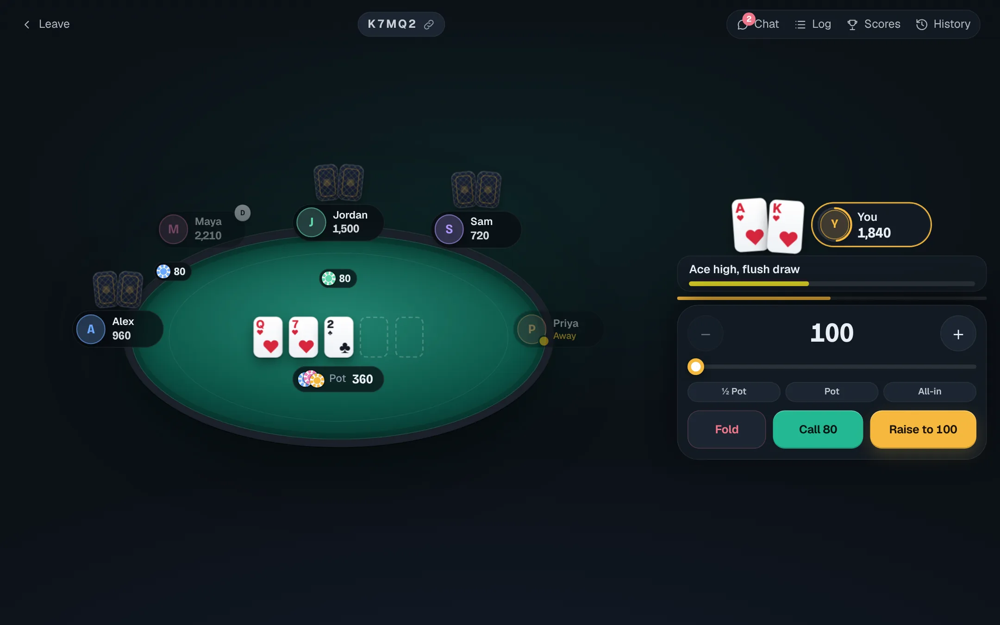
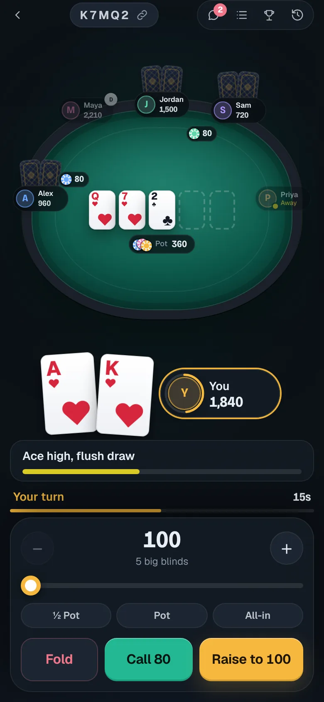
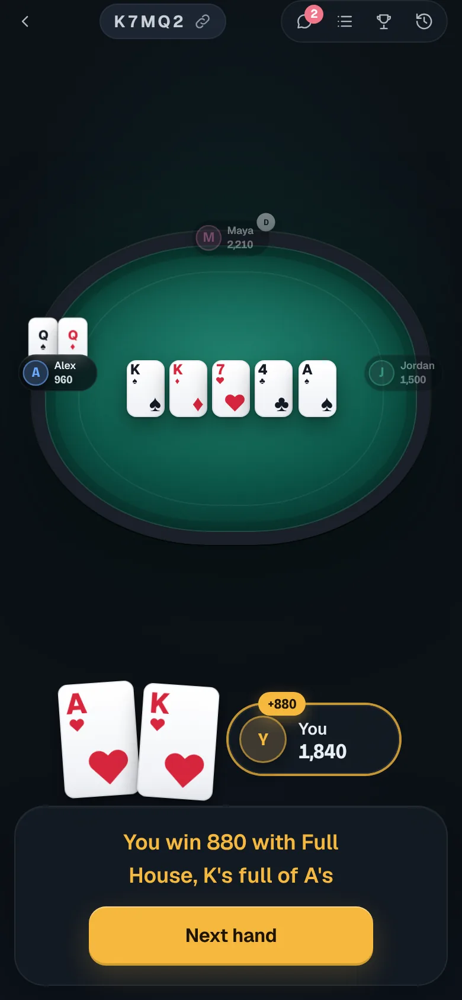
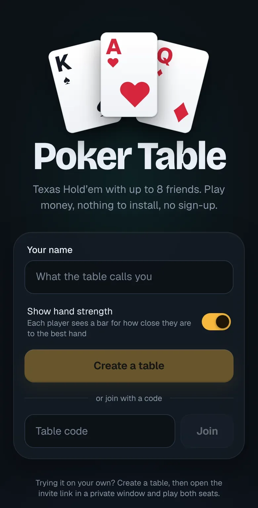

# Poker Table

**Play-money Texas Hold'em for 2 to 8 friends, in the browser.** Share a link, everyone takes a seat, and the server deals. No accounts, nothing to install.

**Play it:** [poker-fb69e.web.app](https://poker-fb69e.web.app)
On your own? Create a table, then open the invite link in a private window and play both seats.



<p>
  
  
  
</p>

## What it does

- **2 to 8 players** at one table. Join between hands, rebuy when you bust.
- **The full game:** blinds, betting rounds, all-ins, side pots, showdown and split pots, with a 30-second turn clock (drawn as a ring around the player's avatar).
- **A nut meter** (host setting): one bar, red to green, showing how close your hand is to the best possible hand on this board. It's exact, not a simulation.
- **Table chat, an action log, hand history** and a scoreboard that counts rebuys.
- **Works at every size:** phone upright or sideways, small laptop windows, big screens. Installable to the home screen.
- **Survives real life:** players who close the tab are marked away, then skipped, so the table never stalls. An open app notices a new deploy and offers to refresh.

## How it works

Built with **React 19, TypeScript, Tailwind CSS v4, Motion, Zustand, and Firebase** (Anonymous Auth, Firestore, Cloud Functions, Hosting). Tested with Vitest.

**The server is the dealer.** The browser never writes game state. Every move calls a Cloud Function, which checks it against the shared rules engine inside a Firestore transaction and writes the result. Every screen then redraws from the database.

**Nobody can see cards they shouldn't.** A hand is stored in three places, written together:

| Document                     | Holds                                               | Who can read it      |
| ---------------------------- | --------------------------------------------------- | -------------------- |
| `rooms/{code}/secret/hand`   | the full hand, including the deck                   | nobody (server only) |
| `rooms/{code}/hand/current`  | the public view: pot, board, whose turn, the result | players at the table |
| `rooms/{code}/private/{uid}` | that player's two hole cards                        | only that player     |

**One engine, three users.** `shared/engine/` is plain TypeScript with no React or Firebase: the Cloud Functions, the browser and the tests all import it. All per-player data is indexed by table seat 0 to 7.

The reasoning behind 75+ design choices is in **[DECISIONS.md](DECISIONS.md)**, and [INTERVIEW_PREP.md](INTERVIEW_PREP.md) has the questions I practise with.

## Testing

- **Unit tests** for every engine function, written test-first, plus the UI's pure logic (betting options, seat layout, result wording...).
- **Stress test** (`shared/engine/fuzz.test.ts`): plays hundreds of random seeded games with 2 to 8 players and random stacks, and after every move checks what must always hold: chips conserved, 52 unique cards, the right board size, payouts equal to the pots. A failure prints the seed so the exact game can be replayed.
- **Smoke tests** (`scripts/smoke.mjs`, `scripts/smoke-multi.mjs`): with the emulators running, play real hands through the real functions and try to cheat (read the deck or another player's cards, act out of turn, send a malformed move).
- **CI** (`.github/workflows/ci.yml`) runs lint, formatting, all tests and both builds on every push.

## Performance

- The lobby downloads about **115 KB** of JavaScript (gzipped). Firestore, the animation library and the table page load in the background while you're in the lobby.
- Libraries are split into their own chunks (React, Firebase core, Firestore, Motion). They're cached forever and change rarely, so after a deploy a returning player only downloads the app code that changed.
- The hand evaluator is server-only; the browser never downloads it.
- Fonts are bundled with the app instead of fetched from Google.

## Running it locally

You need Node.js 22 and Java 21+ (for the Firestore emulator).

```bash
npm install
npm --prefix functions install
npm --prefix functions run build
```

Then, in two terminals:

```bash
npm run emulators   # Auth + Firestore + Functions emulators (UI at http://localhost:4000)
npm run dev         # the app at http://localhost:5173
```

Click **Test emulator connection** on the home screen to check everything is wired up. Set `TURN_SECONDS=10` before `npm run emulators` for a short turn clock. Rebuild the functions after changing `functions/` or `shared/` (or keep `npm --prefix functions run build:watch` running).

**Design preview:** with `npm run dev` running, open [localhost:5173/preview](http://localhost:5173/preview) to see the table drawn from made-up hands (`?s=flop`, `preflop`, `full`, `showdown`, `waiting`, `join`), no emulators needed. It isn't part of the deployed build.

| Command             | What it does                                       |
| ------------------- | -------------------------------------------------- |
| `npm run dev`       | Vite dev server                                    |
| `npm run build`     | Type-check and production build                    |
| `npm test`          | Vitest (engine and UI logic, plus the stress test) |
| `npm run lint`      | oxlint                                             |
| `npm run format`    | Prettier (with Tailwind class sorting)             |
| `npm run emulators` | Firebase emulators, data kept in `emulator-data/`  |

## Deploying

Copy `.env.example` to `.env.production.local` and fill in the Firebase web settings, then:

```bash
npx firebase deploy --only hosting --project production              # site only
npx firebase deploy --only functions,hosting --project production    # after server or engine changes
```

### Turning on App Check (optional)

App Check makes the Cloud Functions refuse requests that don't come from this site.

1. In the Firebase console, open App Check, register the web app with **reCAPTCHA Enterprise**, and copy the site key.
2. Put it in `.env.production.local` as `VITE_APPCHECK_SITE_KEY=...` and deploy hosting. The site now sends App Check tokens.
3. Watch the App Check metrics until nearly all requests are verified. Then create `functions/.env` with `ENFORCE_APP_CHECK=true` and deploy functions.

## Project layout

```
src/             React app: pages, components, store, lib (pure helpers with tests)
shared/engine/   The rules: pure TypeScript, used by the client, the functions and the tests
functions/       Cloud Functions (one per move: createRoom, joinRoom, playAction...)
firestore.rules  Clients read only; hole cards readable only by their owner
scripts/         Smoke tests against the emulators
docs/            README screenshots
```

## What's next

- A bot opponent, so one person can try a full game alone.
- The full no-limit minimum-raise rule (currently: at least one big blind more).
